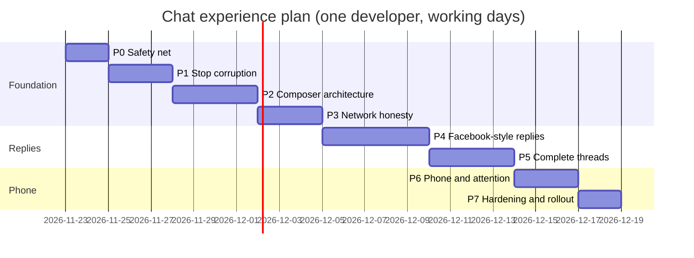

# Tupo chat experience: implementation plan

**Date:** 19 November 2026
**Implements:**
- [CHAT_COMPOSER_GAP_ANALYSIS_2026-11-19.md](CHAT_COMPOSER_GAP_ANALYSIS_2026-11-19.md): typing, slow networks, data loss (G-01 to G-16).
- [CHAT_REPLIES_UX_GAP_ANALYSIS_2026-11-19.md](CHAT_REPLIES_UX_GAP_ANALYSIS_2026-11-19.md): replies, threads, conversation flow (R-01 to R-13, C-01 to C-07).

**Base branch:** `feat/responsiveness-m5b`, once it has merged to `main`.
**Team assumption:** one full-stack developer. Estimates are working days and include tests.

---

## 1. Goals and what "done" means

| Quality | Measured by | Target |
|---|---|---|
| **Reliable** | Text typed, sent, edited or replied is never lost or changed by the app | 0 failures in `verify:composer:slow` and `verify:chat:replies`, at Slow 3G + 2 s latency |
| **Efficient** | Keystroke to paint, in a 200-message conversation, 6× CPU throttle | p50 < 16 ms, p95 < 50 ms; `MessageRow` renders per keystroke = 0 |
| | Network per message typed | ≤ 1 draft save per 3 s of typing; 0 echoes to the typing tab |
| | Bundle | Chat route chunk grows ≤ 15 KB gzip in total (`scripts/check-bundle.mjs`) |
| **User friendly** | Replies visible without opening anything | Summary line with faces under every thread root; latest 3 replies one tap away |
| | One reply verb | "Reply" everywhere; quote in channel is a ⋯ option |
| **Interactive** | Every message action exists in the main flow, in threads and on phones | Parity checklist (§9) 100% |
| | Feedback | Every action shows pending, then done or failed with a retry. A toast on every outcome, a skeleton for every load |
| **Responsive** | 360, 390, 768, 1024, 1440 px | No horizontal page scroll; touch targets ≥ 44 px; the thread is full screen below 768 px |
| **Modern** | Platform features used where supported, with fallbacks | `field-sizing`, View Transitions, `content-visibility`, `useSyncExternalStore`, `navigator.vibrate`, `AbortSignal.timeout` |
| **Realistic** | Each phase ships on its own and can be rolled back alone | One PR per phase; flags on risky UI; migrations are additive only |

### Design rules every phase must follow

These are the NGA UI rules, plus rules from the reports.

- **Colour and depth.** Blue only: no violet, purple, indigo, sky or cyan. Flat: **no shadows** on new or changed components, and existing `shadow-xl`/`shadow-2xl` on touched menus are removed. **No left or top accent strips.** The current quote's `border-l-2` is replaced by a tinted block (§5.4).
- **Feedback.** A skeleton for every API-backed view; a toast for every action outcome.
- **Motion.** Every motion respects `prefers-reduced-motion`.
- **Shared code.** Every text box uses the same composer core (§4.3), so a fix lands everywhere at once.

---

## 2. Phases at a glance

| Phase | Name | Gap IDs | Days | Ships behind a flag? | Migration |
|---|---|---|---|---|---|
| 0 | Safety net and baselines | (tests for all) | 2 | n/a | none |
| 1 | Stop corrupting text; make replies readable | G-01, G-03, G-06, G-08, G-14, R-01, C-01, C-04, C-06 | 3 | no (fixes) | none |
| 2 | Fast composer and render architecture | G-02, G-09, G-11, G-15, G-16 | 4 | no | none |
| 3 | Honest network behaviour | G-04, G-05, G-07, G-10, G-12, G-13 | 3 | no | none |
| 4 | Facebook-style replies | R-02, R-03, R-06, R-07, R-08, R-10 | 5 | `chat.inlineReplies` | 0046 |
| 5 | Complete threads | R-04, R-05, R-11, R-12, R-13, C-05, C-07 | 4 | `chat.threadPage` | 0047 |
| 6 | Phone ergonomics and attention | C-02, C-03, R-09 | 3 | `chat.actionSheet` | 0048 |
| 7 | Hardening, rollout, clean-up | — | 2 | removes flags | none |
| | **Total** | 36 gaps | **≈ 26 days (5–6 weeks)** | | |



**Order and why:**
- **P1 goes first.** It ends the bug people are reporting, with small, low-risk changes.
- **P2 comes before any new reply UI.** The inline thread composer in P4 reuses its composer core; built earlier, it would inherit G-01, G-03 and G-06.
- **P3 comes before P4.** Inline replies have to be optimistic and durable from day one.
- **P6 needs P5.** The phone action sheet and the full-screen thread page share the same `MessageRow` actions.

**Releases:** pushing to `main` deploys to production (concurrency-queued), and migrations run with the deploy. Every phase is one PR. A merge and deploy happens only when you ask for it explicitly.

---

## 3. Phase 0: Safety net and baselines (2 days)

The aim is to write the checks first, so every later phase proves itself against them.

| # | Task | Files |
|---|---|---|
| 0.1 | Fix the Playwright browser mismatch: pin `playwright` to match the installed build, or add `npx playwright install chromium` to `npm run preflight`. | `package.json`, `scripts/preflight*` |
| 0.2 | New suite **`verify:composer:slow`**. Seven cases from the composer report §7 (draft echo, send during save, two tabs, slow thread reply, failed edit, IME Enter, double flush). Expected to **fail** today; record the failures. | `scripts/verify-composer-slow.mjs` |
| 0.3 | New suite **`verify:chat:replies`**, testing the replies report §6 criteria 1–8. Includes `scrollWidth <= innerWidth` and bubble ≤ column width at 360, 390 and 1440 px. | `scripts/verify-chat-replies.mjs` |
| 0.4 | Perf harness: a dev-only `?perf=1` mode that wraps the chat in `<Profiler>`, counts `MessageRow` commits per input event, and logs keystroke-to-paint with `performance.mark` plus `requestAnimationFrame`. The suite drives 100 keystrokes at 6× CPU throttle and stores p50 and p95. | `apps/web/src/lib/perf.ts`, `scripts/verify-composer-perf.mjs` |
| 0.5 | Visual baseline: screenshots of five fixed screens at five widths (channel, thread, quote, phone long-press, threads inbox), stored for side-by-side review in PRs (not pixel-diffed in CI). | `scripts/chat-visual-baseline.mjs`, `.chat-visual/` (gitignored) |
| 0.6 | A tiny runtime flag helper: flags come from `GET /api/config` (env `TUPO_FLAGS=chat.inlineReplies,…`) and can be forced per device with `localStorage['tupo.flags']`. | `apps/api/src/routes/config.ts`, `apps/web/src/lib/flags.ts` |
| 0.7 | Client counters, sent to the existing error/observability endpoint (0043): `chat.draft.conflict_dropped`, `chat.send.ack_timeout`, `chat.send.rest_fallback`, `chat.outbox.flush_joined`, `chat.edit.rollback`. They prove the fixes work in production. | `apps/web/src/lib/errorReport.ts` |

**Done when:** both new suites run and fail where the reports say they should, and baseline perf numbers are written in §11 of this file.

---

## 4. Phases 1–3: reliability and speed

### 4.1 Phase 1: Stop corrupting text; make replies readable (3 days)

**Draft echo (G-01).** Belt and braces: each of these alone stops the bug.

| # | Task | Files |
|---|---|---|
| 1.1 | Per-tab id `tabId = crypto.randomUUID()` (sessionStorage), sent as the `X-Tupo-Tab` header on every request. | `apps/web/src/lib/api.ts` |
| 1.2 | `PUT /draft` accepts `{ draft, clientSavedAt }`. It stores `draft_saved_at` and **ignores a save older than the stored one** (last-write-wins by client time, clamped to server now + 5 s). It echoes `{ draft, at, origin: tabId }`. | `apps/api/src/routes/chat.ts`, `packages/chat/src/service.ts` (`saveDraft`) |
| 1.3 | `onDraft` drops the event when `origin === tabId`, when `at <= local savedAt`, or when this conversation's composer has focus or changed in the last 5 s. In that last case it keeps it as `remoteDraft` for an optional "Draft from another device: Use it" chip. | `ChatProvider.tsx` |
| 1.4 | One `AbortController` per conversation for draft PUTs; a new save aborts the previous one. | `ChatProvider.tsx` |
| 1.5 | `send()` clears the draft timer, aborts any in-flight PUT, and records `lastSentText` per conversation. A remote draft equal to `lastSentText` is ignored for 30 s. | `ChatProvider.tsx` |

`draft_saved_at` fits the existing `conversation_members.draft` row as a nullable column. It is added in 0046 with the P4 columns; until then the server compares against the in-memory time in Redis key `draft:at:<uid>:<cid>` (TTL 1 day). No migration is needed in P1.

**Other P1 fixes:**

| # | Gap | Task |
|---|---|---|
| 1.6 | G-03 | Thread box: snapshot the text, clear it at once, and put it back only on failure, and only if the box is still empty. |
| 1.7 | G-06 | `isComposing(e)` guard (`e.nativeEvent.isComposing \|\| e.keyCode === 229`) in the composer, thread box, edit box and the slash/mention pickers. |
| 1.8 | G-08 | In the edit box, Enter on touch inserts a newline and Save is a button. Hide the hint text on touch. |
| 1.9 | G-14 | The thread box gets the length check and the counter (shared helper). |
| 1.10 | R-01 | Bubble gets `min-w-0 max-w-full overflow-hidden`. The quote becomes a wrapped block with `line-clamp-2`, no `nowrap`, and a **tinted background instead of `border-l-2`**. |
| 1.11 | C-01 | Sticky date chip on a full-width solid strip matching the list background (`bg-surface-light/95` with `backdrop-blur-sm`, no shadow). Text scrolls under it. |
| 1.12 | C-04 | "Jump to latest" becomes a 44 px round blue button at the bottom right with an unread badge, plus `scroll-padding-bottom` so the last message is never covered. |
| 1.13 | C-06 | Phone placeholder: "Message" in channels and the first name in DMs, single line. |

**Done when:**
- `verify:composer:slow` cases 1–3, 4 and 6 pass.
- `verify:chat:replies` criterion 1 passes.
- `verify:optimistic`, `verify:sync` and `verify:chat:threads` stay green.

**Rollback:** the client and server changes are each backward compatible. An old client without `X-Tupo-Tab` gets the old behaviour, and an old server ignores the new fields.

### 4.2 Phase 2: Fast composer and render architecture (4 days)

**Target architecture:**

```
ChatProvider (thin)
├── ChatActionsContext   – stable callbacks only (send, react, edit, openThread…); value never changes
├── chatStore            – external store (messages, conversations, typing, presence, ui)
│     useChatSelector(sel, eq)  → useSyncExternalStore; a component re-renders only when its slice changes
└── draftStore           – drafts: memory + IndexedDB (authoritative) + server (background copy)
```

| # | Task | Files |
|---|---|---|
| 2.1 | Build `chatStore`, a small hand-written store (no new dependency): `getState`, `setState(patch)`, `subscribe`, plus a `useChatSelector` hook with shallow-equal. Move `messages`, `conversations`, `typingByConv`, `convPresence`, `threadUnread`, `editingId`, `highlightedId` and `replyTarget` into it. | `apps/web/src/pages/chat/store.ts` (new), `ChatProvider.tsx` |
| 2.2 | Keep `useChat()` as a **compatibility shim** that returns everything, so the 26 consumers keep working. Migrate the hot ones first: `MessageThread`, `MessageRow`, `ConversationList`, `Composer`, `ChatLayout`, `useModuleBadges`. The rest move opportunistically. | 26 files |
| 2.3 | `MessageRow` becomes `React.memo` with props `message`, `newGroup`, `isEditing`, `isHighlighted`, `threadUnread`, `isBlocked`, plus the stable actions. It no longer calls `useChat()`. | `MessageThread.tsx` → split into `MessageRow.tsx` |
| 2.4 | **Composer core** (§4.3), with **local text state**. It pushes to `draftStore` debounced (300 ms) and on blur, conversation switch and `pagehide`. External text is applied only when not focused, keeping the selection (G-16). | `ComposerCore.tsx` (new), `Composer.tsx`, `ThreadPanel.tsx` |
| 2.5 | `draftStore` (G-09): writes to IndexedDB (`tupo-cache-<uid>`, key `draft:<cid>` or `draft:thread:<rootId>`) on every debounce. It syncs to the server after a 2.5 s pause (G-15), and on `pagehide` with `fetch(…, { keepalive: true })`. Thread drafts persist too, replacing the in-memory `threadDrafts` Map. | `drafts.ts` (new), `lib/localStore.ts` |
| 2.6 | Typing stop (G-11): emit `typing:stop` when the text becomes empty, on blur, on conversation switch and on `pagehide`. | `ComposerCore.tsx`, `ChatProvider.tsx` |
| 2.7 | Auto-grow: CSS `field-sizing: content` with `max-height`, falling back to the existing JS measurement only when `CSS.supports('field-sizing','content')` is false. | `ComposerCore.tsx`, `index.css` |
| 2.8 | `content-visibility: auto; contain-intrinsic-size: auto 72px` on message rows: cheaper off-screen rows below the windowing threshold, and it works with the existing measured spacers. | `index.css` |

**Done when:**
- Perf harness: `MessageRow` commits per keystroke = 0; p50 < 16 ms and p95 < 50 ms at 6× throttle.
- An offline reload keeps both drafts.
- Every existing chat suite stays green.

**Risk:** this is the largest refactor. It is reduced by the `useChat` shim (behaviour is unchanged for consumers that have not migrated yet) and by landing it as 3 commits (store, row, composer) that can each be reverted.

### 4.3 The composer core (used by every text box)

`ComposerCore` owns:
- local value, the selection, and auto-grow;
- the IME guard and the touch-aware Enter rule (`enterToSend` setting, ⌘/Ctrl+Enter);
- the length limit and counter, paste-to-attach, and the mention and slash pickers;
- typing start and stop, and the draft binding (`draftKey`);
- **clear-at-send with restore-on-failure**.

Every box is a thin wrapper around it:

| Wrapper | Where |
|---|---|
| Main composer | `Composer.tsx` |
| Thread panel reply | `ThreadPanel.tsx` |
| Inline thread reply (P4) | `InlineThread.tsx` |
| Edit in place | `MessageRow` edit mode, with `draftKey = null`, a Save button and no attachments |

A unit test file covers its behaviour once: `ComposerCore.test.tsx` (Vitest + Testing Library: IME, Enter rules, clear and restore, caret kept).

### 4.4 Phase 3: Honest network behaviour (3 days)

| # | Gap | Task | Files |
|---|---|---|---|
| 3.1 | G-05 | `request()` defaults to `signal: AbortSignal.timeout(20_000)`, combined with any caller signal (`AbortSignal.any`, with a fallback). The timeout surfaces as `ApiError('timeout')`. | `lib/api.ts` |
| 3.2 | G-05 | `socket.timeout(8000).emit('message:send', …)`. On timeout, fall back to REST with the same nonce (the server already dedups by nonce) and count `chat.send.ack_timeout`. | `ChatProvider.tsx` |
| 3.3 | G-13 | Pending escalation on the bubble: 0–3 s shows the clock; after 3 s "Sending…"; after 15 s "Slow connection, still trying"; then failure shows "Not sent — retry". This is a pure render of `createdAt` against a 1 s ticker that runs only while something is pending. | `MessageRow.tsx` |
| 3.4 | G-10 | Single-flight `outbox.flush()`: a module-level promise; a second caller joins it. | `outbox.ts` |
| 3.5 | G-07 | Thread replies go through `send()` (optimistic bubble, outbox, nonce). Add `alsoSendToChannel` to the socket `message:send` payload, and have the realtime handler call `replyInThread` when `threadRootId` is set. The REST route stays for old clients. | `ChatProvider.tsx`, `apps/realtime/src/chat/handlers.ts`, `packages/shared/src/chatEvents.ts` |
| 3.6 | G-04 | Optimistic edit: apply at once with `delivery:'saving'`; on failure, roll back, reopen the editor with the attempted text, and show a toast with Retry. | `ChatProvider.tsx` (`edit`), `MessageRow.tsx` |
| 3.7 | G-12 | Optimistic delete with rollback (the same pattern as `pin`). A 5 s **Undo** toast before the request is sent, reusing the U-10 undo-send mechanism. | `ChatProvider.tsx` (`remove`) |

**Done when:**
- `verify:composer:slow` passes all 7 cases.
- A new case passes: a half-open socket (Playwright `route` that drops `socket.io` frames) settles a message within 10 s through REST.

---

## 5. Phases 4–5: replies people can see

### 5.1 Phase 4: Facebook-style replies (5 days, flag `chat.inlineReplies`)

**Server (day 1)**

Migration **0046_thread_preview.sql** (additive):

```sql
ALTER TABLE messages
  ADD COLUMN IF NOT EXISTS thread_participants JSONB NOT NULL DEFAULT '[]'::jsonb; -- last 3 distinct repliers [{id,name,avatarUrl}]
ALTER TABLE conversation_members
  ADD COLUMN IF NOT EXISTS draft_saved_at TIMESTAMPTZ;
```

`messages` is partitioned, so `ADD COLUMN` with a constant default is metadata-only on PG ≥ 11 (instant); check the production version first. Then backfill only roots with `reply_count > 0`, in batches of 1,000 (a script, not the migration).

| # | Task | Files |
|---|---|---|
| 4.1 | `replyInThread` / `sendMessage` with `threadRootId` update the root's `thread_participants` (move the replier to the front, keep 3), in the same transaction as the reply-count increment. | `packages/chat/src/service.ts` |
| 4.2 | The wire message gets `threadParticipants` and `threadLatest` (the latest reply's sender name plus the first 80 characters, read with the root). `replyTo` gets `attachmentKind`, `thumbUrl`, `durationMs` and `fileName`, for the quote preview. | `service.ts` (row mapper around line 1096), `packages/shared/src/chat.ts` |
| 4.3 | The thread fetch (`GET …/messages?thread=<root>`) gains `limit` and `before`, so the inline view can ask for the latest 3 and page older ones. Check the existing paging; reuse the main list's cursor if present. | `apps/api/src/routes/chat.ts` |

**Client (days 2–5)**

| # | Gap | Task | Files |
|---|---|---|---|
| 4.4 | R-06 | One **Reply** action: in DMs, quote reply; in channels and groups, thread reply. The hover bar shows a labelled "Reply" (with an icon on desktop). "Quote in channel" moves to the ⋯ menu. Swiping right on a phone means Reply. Keyboard: `R` on a focused message. | `MessageRow.tsx` |
| 4.5 | R-02 | `ThreadSummary` under each root: stacked avatars (up to 3, 20 px, 2 px ring in the bubble background, no shadow), then "Didier and 2 others replied · 5 replies · 2 min". Blue when there are unread replies, with "3 new" in bold. The whole line is a 44 px tap target. | `ThreadSummary.tsx` (new) |
| 4.6 | R-03 | `InlineThread` expands in place (§5.3). Shows the latest 3, "View N earlier replies" (pages 10 at a time, capped at 20 inline), compact `MessageRow`s, an inline `ComposerCore` ("Reply to Claire…"), and "Open thread ↗". Expand and collapse animate height (with reduced-motion respected). The open state is remembered per root in IndexedDB. It auto-expands when the thread has unread replies for me. | `InlineThread.tsx` (new) |
| 4.7 | R-03 | Replying to a reply stays one level deep and pre-fills `@Name `, with the caret after it. | `InlineThread.tsx` |
| 4.8 | R-07 | A message with `metadata.fromThread` shows "↳ Replied in a thread · View 5 replies", which opens that thread, instead of a plain quote. | `MessageRow.tsx` |
| 4.9 | R-08 | `QuotePreview`: the label "You replied to Bosco" / "Claire replied to you" above the bubble, a tinted block (no strip), 2-line clamp, and a 32 px thumbnail plus type and length for media. Tested for WCAG AA contrast on blue. | `QuotePreview.tsx` (new) |
| 4.10 | R-10 | Jump history: tapping a quote pushes the current anchor (message id plus offset). A "↩ Back to reply" pill appears for 10 s or until used, and handles chains of jumps. | `MessageThread.tsx`, `useJumpHistory.ts` (new) |

**Realtime:** `thread:reply` events already update the root. Extend the payload with `threadParticipants` and `threadLatest`, so open inline threads and summaries update live, and append to an expanded `InlineThread` without a refetch.

**Done when:**
- `verify:chat:replies` criteria 1, 2 and 6 pass.
- Visual review at 5 widths is approved.
- With the flag off, the UI is exactly the P3 UI, and the server fields are present but ignored.

### 5.2 Phase 5: Complete threads (4 days, flag `chat.threadPage`)

Migration **0047_thread_follows.sql**:

```sql
CREATE TABLE IF NOT EXISTS thread_follows (
  conversation_id TEXT NOT NULL REFERENCES conversations(id) ON DELETE CASCADE,
  root_id         TEXT NOT NULL,
  user_id         TEXT NOT NULL REFERENCES users(id) ON DELETE CASCADE,
  state           TEXT NOT NULL CHECK (state IN ('following','muted')),
  updated_at      TIMESTAMPTZ NOT NULL DEFAULT now(),
  PRIMARY KEY (root_id, user_id)
);
```

`threadFollowers` changes from implicit participants to `(participants ∪ following ∪ auto) − muted`:
- **auto** means people @mentioned in the thread, and the owners and moderators of channels with 50 members or fewer;
- the RLS policy follows the tenant pattern used by the other chat tables (multi-tenancy plan).

| # | Gap | Task | Files |
|---|---|---|---|
| 5.1 | R-04 | Thread replies render with `MessageRow variant="compact"`: every action, gesture, delivery state, edit, delete and report. Remove `ThreadMessage`. | `ThreadPanel.tsx`, `MessageRow.tsx` |
| 5.2 | R-05 | `?thread=<rootId>` in the URL (add to `PANELS_IN_URL` handling). Back closes the thread. Push notifications and digest emails for thread replies link to it. | `ChatLayout.tsx`, `useChatUrl.ts`, `apps/worker` notification payloads |
| 5.3 | R-05 | Below 768 px the thread is a **full-screen page** (not a 90 vw overlay): ← back plus the root summary in the header, and a View Transition slide where supported. | `ChatLayout.tsx`, `ThreadPanel.tsx` |
| 5.4 | R-11 | "Following ✓ / Follow" toggle in the thread header and in the `ThreadSummary` ⋯ menu; "Mute thread" sets `muted`. Endpoints: `PUT /conversations/:id/threads/:rootId/follow { state }`. | `routes/chat.ts`, `service.ts`, `ThreadPanel.tsx` |
| 5.5 | R-12 | First-unread divider inside the thread (from `thread_reads`); open at it. | `ThreadPanel.tsx` |
| 5.6 | R-13 | Threads inbox rows show the last reply ("Bosco: Also check…") with an avatar, plus an **Unread** filter chip. | `ThreadsInbox.tsx`, `followedThreads()` |
| 5.7 | — | "Didier is replying…" for threads: `typing:start` gains an optional `threadRootId`; it shows under the `ThreadSummary` and at the bottom of the thread. | `packages/shared/src/events.ts`, realtime typing handler, `ThreadSummary.tsx` |
| 5.8 | C-05 | Opening a panel from the hover bar moves focus into the panel's composer, so the bar no longer sticks. | `MessageRow.tsx` |
| 5.9 | C-07 | Keep the anchor across a width change: a `ResizeObserver` on the list keeps the opening message at the same offset when the panel opens or closes. | `MessageThread.tsx` |

**Done when:**
- `verify:chat:replies` criteria 3 and 4 pass.
- The parity checklist (§9) is 100% for thread replies.
- `verify:chat:threads` still passes (containment unchanged).

---

## 6. Phase 6: Phone ergonomics and attention (3 days)

| # | Gap | Task | Files |
|---|---|---|---|
| 6.1 | C-02 | **`MessageActionSheet`** for touch. The long-pressed message is raised over a dimmed backdrop (`bg-black/40`, no shadow). It has a 6-emoji reaction row plus "+", and labelled 52 px rows: Reply · Forward · Copy · Save · Pin · Edit · Delete · Report. It drags down to dismiss, vibrates (`navigator.vibrate(10)`) when it opens, traps focus, and closes with Back or Escape. The hover bar never renders on `pointer: coarse`. | `MessageActionSheet.tsx` (new), `MessageRow.tsx`, `useTouchGestures.ts` |
| 6.2 | C-02 | Double-tap a message to add 👍 (configurable in Settings; off when "reduce motion" is set). | `useTouchGestures.ts` |
| 6.3 | C-03 | Open at the first unread: if the divider is more than one screen above the bottom, place it at 30% of the view. The pill reads "↓ 40 new messages". | `MessageThread.tsx` |
| 6.4 | R-09 | "Replied to you": in `sendMessage`, when `replyToId` points at another user's message (and that user is not already mentioned), insert `message_mentions(kind='reply')`. This raises `unread_mentions`, appears in the mentions filter, and sends a push titled "Claire replied to you". A Settings toggle "Notify me when someone replies to my message" defaults on. | `service.ts`, `apps/worker` push, `NotificationSettings.tsx` |
| 6.5 | — | Touch audit across all chat screens: targets ≥ 44 px, `touch-action` correct, safe-area insets on the sheet and the thread page, landscape phone, iPad split view. | various |

Migration **0048_reply_notify_pref.sql**: add a `notify_replies BOOLEAN NOT NULL DEFAULT true` column to the user notification preferences table.

**Done when:**
- `verify:chat:replies` criteria 5, 7 and 8 pass.
- `verify:chat:touch` is extended with the sheet and passes.
- A manual check on one real Android phone and one iPhone, recorded in §11.

---

## 7. Phase 7: Hardening, rollout, clean-up (2 days)

| # | Task |
|---|---|
| 7.1 | Full regression: typecheck, API tests, every `verify:*` suite (51 + 3 new), bundle check. |
| 7.2 | Accessibility pass: axe-core on chat screens with 0 serious issues; screen reader check of the summary line ("5 replies from Didier, Bosco and 1 other, 3 new, button"), the sheet, and the inline thread (`aria-expanded`, `role="log"` for appended replies). |
| 7.3 | Dark-mode screenshots of every new component, checked against the blue-only and no-shadow rules. |
| 7.4 | Staged rollout (§8). |
| 7.5 | Remove the flags and dead code (the old quote, `ThreadMessage`, the `useChat` shim if every consumer has migrated). Update `TUPO_SRS.md` (FR-MSG-6, FR-MSG-7, FR-MSG-17) and the two gap reports' status columns. |

---

## 8. Rollout

| Step | Who gets it | Watch for | Go to the next step when |
|---|---|---|---|
| P1–P3 deploys | Everyone (fixes, no flag) | `chat.draft.conflict_dropped` > 0 (the fix working); `chat.send.ack_timeout` rate; error reports | 48 h with no new chat error class |
| P4 flag on for staff | `TUPO_FLAGS` scoped to staff roles (the flag helper takes a role list) | Inline thread errors; reply volume; feedback in the staff channel | 3 school days, no blocker |
| P4–P6 on for everyone | All users | Same, plus push volume from "replied to you" (rate limit: at most 1 push per thread per 5 min) | 1 week stable, then remove the flags (P7) |

**Rollback:** each flag turns off at runtime. Migrations are additive, so they are never rolled back; old code ignores the new columns. For a code rollback, use `scripts/release.sh`.

---

## 9. Message action parity checklist

| Action | Main flow (desktop) | Main flow (phone sheet) | Thread / inline (desktop) | Thread / inline (phone) |
|---|---|---|---|---|
| React, quick and picker | ✓ today | P6 | P5 | P5 + P6 |
| Reply (one verb) | P4 | P6 | P4 (`@Name`) | P5 |
| Quote in channel | P4 (⋯) | P6 | n/a | n/a |
| Edit (optimistic, rollback) | P3 | P6 | P5 | P5 |
| Delete with Undo | P3 | P6 | P5 | P5 |
| Copy / link / save / forward / pin | ✓ today | P6 | P5 | P5 |
| Report | ✓ today | P6 | P5 | P5 |
| Pending → slow → failed + retry | P3 | P3 | P3 (via `send()`) | P3 |
| Mark unread | ✓ today | P6 | n/a | n/a |

---

## 10. Risks and how they are handled

| Risk | Likelihood | Impact | Handling |
|---|---|---|---|
| The P2 store refactor breaks a subtle live update (typing, presence, unread) | Medium | High | `useChat` shim; migrate hot consumers only; the `verify:sync`, `verify:realtime:restart` and `verify:local-first` suites gate the merge; 3 revertible commits |
| Inline threads make busy channels noisy again | Medium | Medium | Collapsed by default; 3 inline, 20 maximum before "Open thread"; auto-expand only for my unread; measure with staff first |
| `thread_participants` backfill is slow on the partitioned `messages` | Low | Medium | Batched script outside the migration; only roots with `reply_count > 0`; runs after the deploy, and the UI degrades to the count alone until it is done |
| "Replied to you" push floods | Medium | Medium | One per thread per 5 min; respects mute and DND; opt-out toggle |
| `field-sizing`, View Transitions or `AbortSignal.any` are missing on older school Chromebooks or iOS 16 | High | Low | Feature-detected with fallbacks (JS auto-grow, no transition, manual signal merge) |
| A production Postgres older than 11 makes 0046's `ADD COLUMN … DEFAULT` rewrite the partitions | Low | High | Check `SELECT version()` on prod before P4; if it is older than 11, add the column without a default and backfill |
| Deploy collisions (push to main deploys) | Low | Medium | One PR per phase; the deploy concurrency group already queues; merge only on an explicit ask |

---

## 11. Status log (fill in as phases land)

| Phase | PR | Merged / deployed | Baseline → result | Notes |
|---|---|---|---|---|
| 0 | | | keystroke p50/p95: __ / __ ms; row commits per key: __ | |
| 1 | | | slow suite: _/7 | |
| 2 | | | p50/p95: __ / __ ms; row commits: 0 | |
| 3 | | | slow suite: 7/7 | |
| 4 | | | replies suite: _/8 | flag `chat.inlineReplies` |
| 5 | | | | flag `chat.threadPage`, mig 0047 |
| 6 | | | | flag `chat.actionSheet`, mig 0048; device check: Android __, iPhone __ |
| 7 | | | | flags removed |
